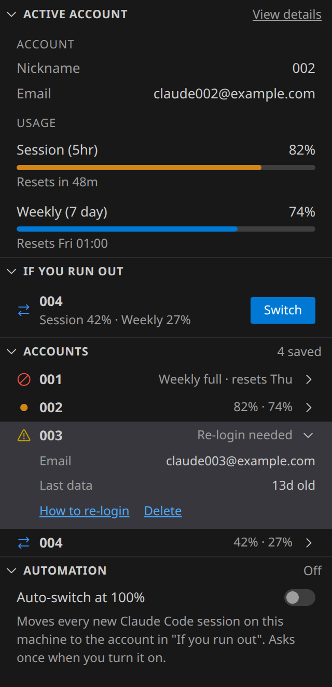
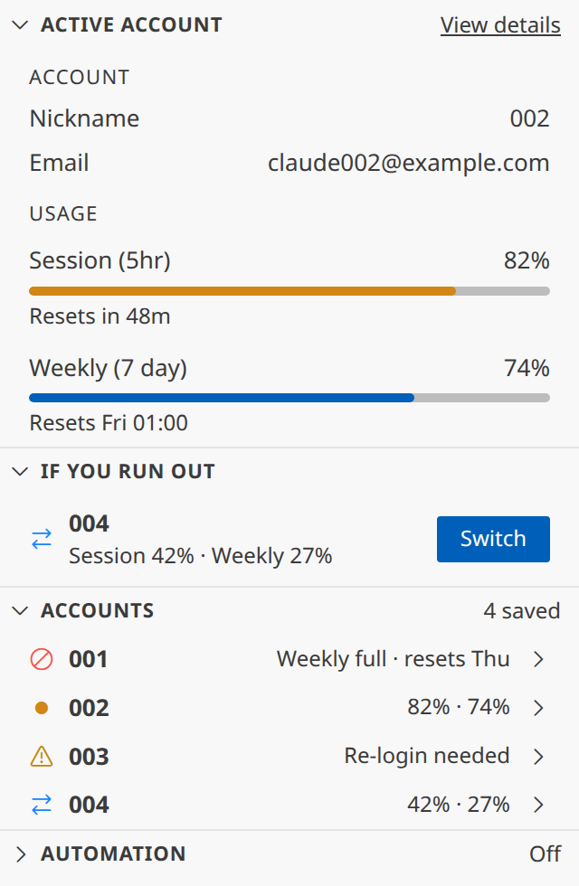

# cc-usage-bar

A multi-line Claude Code statusLine usage bar, plus `ccswitch` — a small CLI
for saving, switching between, and monitoring rate-limit headroom across
multiple Claude accounts.

```
Ctrl CV · jane@acme.com                 Opus 4.8 (1M context) · high
5H ▕▰▰▱▱▱▱▱▱▏  24% ↻ 3h 2m   ·   WK ▕▰▰▱▱▱▱▱▱▏  24% ↻ 3d 23h   ·   CTX ▕▰▰▱▱▱▱▱▱▏  19%
```

Two rows: identity + model on top, then three slim capsule meters — 5-hour,
weekly, and context window — on one line. Rendered in your terminal with
256-color ANSI. The capsule fill is a danger signal: sage under 60%, amber
60–85%, red above 85% — so a near-limit meter always reads red regardless of
which one it is. The `5H` / `WK` / `CTX` labels carry distinct calm tints so
they stay easy to tell apart; caps and the empty track are dim grey. The
block above is the plain-text equivalent.

## What it does

- **`statusline-usage.sh`** — a Claude Code `statusLine` script. Every render
  it reads the JSON Claude Code feeds it on stdin and prints two rows:
  account and model on top, then the 5-hour, weekly, and context-window
  meters (with reset countdowns) on one line underneath.
- **`subagent-statusline.sh`** — a Claude Code `subagentStatusLine` script.
  It replaces each subagent's row in the agent panel with its type, label,
  model, session size (`ctx`), tokens read with the cached share (`tok`),
  cache misses, running time or done, and worktree.
- **`ccswitch`** — save the currently logged-in Claude account under a
  label, list saved accounts, switch between them, or delete one.
- **`ccswitch usage`** — an all-account monitor: polls the 5h/weekly usage
  for every saved account so you can see at a glance which one has the most
  headroom, then optionally switch straight to it.
- **`vscode/`** (optional, `./install.sh --vscode`) — the same accounts in a
  VS Code sidebar and status bar: usage bars, which account has the most
  headroom, one-click switching, and an opt-in auto-switch.

## Requirements

- `bash`, `jq` — required by both scripts.
- `date` — required by the bar and by `ccswitch usage` (the usage monitor);
  `ccswitch save/list/<label>/delete` don't call it.
- `curl` — required only by `ccswitch usage` (the usage monitor); the bar
  and `ccswitch save/list/<label>/delete` don't need it.
- `node` — required only by `ccswitch usage` to refresh expired account tokens
  (the refresh endpoint is behind Cloudflare, which blocks headless `curl`;
  Node's client passes, same as Claude Code). Claude Code ships Node, so you
  already have it.
- Targets Claude Code on Linux and macOS.

## Install

```
git clone <this-repo-url>
cd cc-usage-bar
./install.sh
```

`install.sh`:

- Copies `statusline-usage.sh` and `ccswitch` into `~/.claude/` and makes
  them executable.
- Symlinks `ccswitch` into `~/.local/bin` so you can run it as a bare
  `ccswitch` command. If `~/.local/bin` isn't on your `PATH`, it prints the
  exact `export PATH=...` line to add (and meanwhile you can run it by full
  path, `~/.claude/ccswitch`).
- Checks `jq` is on `PATH` (hard requirement; exits with an install hint if
  missing) and warns, non-fatally, if `curl` is missing.
- Merges the `statusLine` entry into `~/.claude/settings.json` — creating
  the file if it doesn't exist, or backing it up to `settings.json.bak` and
  merging in place (via `jq`) if it does, so no other keys are touched.
- Offers to append a `ccw` shell function (switch-and-relaunch shorthand) to
  `~/.bashrc` (or `~/.zshrc` if your shell is zsh); only appends once.
- Is safe to run more than once. Run `./install.sh --print-only` to see
  exactly what it would write without touching anything.

To wire up the statusLine by hand instead, merge this into
`~/.claude/settings.json`:

```json
{
  "statusLine": {
    "type": "command",
    "command": "~/.claude/statusline-usage.sh",
    "refreshInterval": 5
  }
}
```

### Uninstall

```
./uninstall.sh
```

Removes the two scripts from `~/.claude`, the `~/.local/bin/ccswitch` symlink,
and the `statusLine` entry from `settings.json` — each only if it is still
ours, so a `statusLine` you have since repointed at your own script survives.
Your saved accounts under `~/.claude/accounts/` are **kept**: they are live
OAuth credentials that exist nowhere else. Add `--purge-accounts` to delete
them too (it asks first). `--print-only` shows what it would do.

## Usage — the bar

Once the statusLine is configured, Claude Code renders two rows above the
prompt:

- **Row 1** — account identity (`org · email`, from `~/.claude.json`, when
  available) and the active model and effort level.
- **Row 2** — three capsule meters side by side: `5H` (rolling 5-hour rate
  limit) and `WK` (weekly rate limit), each with a reset countdown (`↻`),
  plus `CTX` (how full the current session's context window is).

Before Claude Code has received a first API response in the session, the `5H`
and `WK` meters show `—` instead of a bar. `settings.json`
sets `refreshInterval: 5`, so the bar redraws every 5 seconds; percentages
update in discrete steps as new usage data arrives from Claude Code — this
is not a smooth, mid-generation animation.

## Usage — the subagent rows

While subagents run, Claude Code shows one row per agent below the prompt.
With `subagentStatusLine` configured, each row reads:

```
engineer · T4 roles · sonnet 5.5 · ctx 368k (36%) · tok 33.6M (99% cached) · 2 cache misses · running 18m · infrasel-sh-t4
```

- **`ctx 368k (36%)`** — the agent's session size now: the tokens in its
  context (its prompt plus everything it has read, written and said so far),
  and that as a share of its model's window. Amber from 60%, red above 85%. A
  role agent past 40% usually carries old work it no longer needs: finish it
  and start a fresh one. This is Claude Code's own per-agent `tokenCount`.
- **`tok 33.6M (99% cached)`** — every input token the agent's calls have read
  so far (each call re-reads the whole context), counted once per API call, and
  the share of it served from the prompt cache. A high cached share is good:
  cache reads cost about a tenth of fresh input.
- **`2 cache misses`** — calls that rewrote more than 100k tokens of cache after
  the first call: the cache expired while the agent sat idle (for example
  during a long foreground test run). Shown only when above zero.
- **`running 18m`** or **`done`** — still working, and for how long; or finished.
- The worktree name appears when the agent runs outside the lead's directory.

`tok` and the cache misses come from the agent's own transcript
(`~/.claude/projects/<project>/<session>/subagents/agent-<id>.jsonl`). The
script reads only new bytes each tick and keeps its offset under
`${XDG_CACHE_HOME:-~/.cache}/cc-usage-bar/subagents/`, so a tick costs about
30 ms after the first read. The rows show agents of the current session only;
the `5H` and `WK` meters of the main bar show what they cost the account.

## Usage — ccswitch

**Enrollment model:** `ccswitch save <label>` snapshots whichever account is
*currently logged in* to Claude Code. To manage multiple accounts, log into
each one in turn and run `ccswitch save <label>` right after — there's no
way to save an account you aren't currently logged into.

```
ccswitch                     list saved accounts (same as `list`)
ccswitch list                list saved accounts; '*' marks the active one
ccswitch save <label>        snapshot the currently active account
ccswitch <label>             switch to a saved account
ccswitch <label> --relaunch  switch, then exec the `claude` CLI (override
                              the command with CCSWITCH_CLAUDE_CMD)
ccswitch delete <label>      remove a saved account (prompts to confirm)
ccswitch usage --json        usage of every saved account as one JSON document
ccswitch refresh-pause       stop refreshing tokens (usage stays readable)
ccswitch refresh-resume      re-enable token refresh
ccswitch version             print the version (also --version, -V)
ccswitch help                show the full command guide (also -h, --help)
```

Switching **requires restarting Claude Code** — see Caveats below. If you
accepted the `ccw` shell function during install, `ccw <label>` is shorthand
for `ccswitch <label> --relaunch`.

## Usage — the monitor

```
ccswitch usage [--no-switch] [--refresh] [--relaunch] [--json]
```

Shows 5-hour and weekly usage for every saved account in one table, with each
window's reset countdown, so you can decide where to switch before you do it:

```
  ACCOUNT     5H                  WEEK                RESET(5h)   RESET(wk)
* claude001   █▍··········  11%   ████········  33%   4h 11m      3d 21h
  claude003   ············   0%   ████████████ 100%   —           10h 0m
  shanyuan    █▌··········  12%   ▎···········   2%   1h 41m      5d 7h      <- most headroom
```

- The active account is starred; the one with the **most headroom** is flagged.
  Headroom accounts for *both* limits (the higher of 5h/weekly), so an account
  that is idle on 5h but maxed for the week is never flagged as free.
- `RESET(5h)` shows `—` when 5-hour usage is 0% (the API reports no active
  window to reset yet) — the row still shows real weekly numbers.
- If an account's stored access token is rejected (expired, or revoked/rotated
  by a real Claude Code session), the monitor refreshes it automatically and
  retries. The token-refresh endpoint rate-limits bursts, so if too many
  accounts refresh at once a row may briefly show `rate-limited` — that is
  transient (the tool backs off and recovers), not a dead account. A failed
  refresh shows `re-login`; then run `ccswitch <label>` (or log in again) to
  re-enroll that account. **An offline run can also mark expired accounts
  `re-login`**: with no network, a server error (5xx) or a Cloudflare block the
  refresh fails the same way. Run `ccswitch usage` again when you are online
  before you log in again.
- After the table it prompts for a label to switch to (Enter cancels).

Flags:

- `--no-switch` — print the table and exit; skip the switch prompt.
- `--refresh` — bypass the 10-minute usage cache and poll live.
- `--relaunch` — if you do switch from the prompt, exec `claude` afterward
  (same behavior as `ccswitch <label> --relaunch`).

### The Codex row

If Codex CLI is logged in with a ChatGPT plan (`auth_mode` `chatgpt` in
`${CODEX_HOME:-~/.codex}/auth.json`), the table gets one extra row, `codex`,
after the Claude accounts:

```
  codex       —                 ············   0%   —           6d 23h
```

- **Read-only.** ccswitch reads Codex's access token and calls the same usage
  endpoint Codex CLI uses. It never refreshes the token and never writes
  `auth.json`: a refresh would rotate the token under a running Codex CLI and
  log it out. When the token has expired or the endpoint answers 401, the row
  shows `expired` until Codex itself refreshes it (run `codex` once). Any
  other failure (a 403, a timeout after 15 s, a response with no known
  window) shows `—` and is not cached.
- **Single account.** There is one Codex login per `CODEX_HOME`, and it is
  never offered as a switch target or flagged as most headroom.
- Windows the plan does not report show `—` (some plans report only the
  weekly window). Results are cached in `${CODEX_HOME:-~/.codex}/.usage-cache`
  (mode `600`, no token or account id) under the same 10-minute cache and
  429 backoff as the Claude rows.
- No Codex login, or an API-key login, means no row and no other change.
- The row needs at least one saved Claude account: with none, `ccswitch usage`
  stops at "no saved accounts" before the Codex row.

### Machine-readable usage

`ccswitch usage --json [--refresh]` prints one JSON document on stdout and
nothing else (warnings stay on stderr). It implies `--no-switch`: it never
prompts and never switches. It runs the Codex step exactly as the table does
(same cache, `--refresh` and error rules), so it also keeps
`${CODEX_HOME:-~/.codex}/.usage-cache` fresh.

```json
{ "schema": 1, "generated_at": 1792500000,
  "login_health": "known", "login_health_reason": null,
  "accounts": [
    { "label": "work", "provider": "claude", "active": true, "login": "ok", "state": "ok",
      "five_hour_pct": 23, "seven_day_pct": 64,
      "five_hour_reset_epoch": 1792515000, "seven_day_reset_epoch": 1792800000,
      "fetched_at": 1792499900 },
    { "label": "codex", "provider": "codex", "active": false, "login": null, "state": "ok",
      "five_hour_pct": null, "seven_day_pct": 3,
      "five_hour_reset_epoch": null, "seven_day_reset_epoch": 1792900000,
      "fetched_at": 1792499950 } ] }
```

- `login_health`: `known` or `unknown`. `unknown` means this run could not
  judge dead logins; `login_health_reason` says why: `node-missing`,
  `node-too-old`, `refresh-paused` or `refresh-lock-busy` (else `null`).
- `accounts`: saved Claude accounts (`provider` `claude`) in label order, then
  at most one Codex row (`provider` `codex`). `active` is the `*` marker. Tell
  the rows apart by `provider`, not `label`: a Claude account may also be
  called `codex`.
- `state`: the table's row state: `ok`, `dash`, `wait` or `relogin`.
- The Codex row is there when a Codex login or its cache exists, even with no
  saved Claude account. It is read-only: `active` is always `false` and
  `login` is always `null`. Its `state` is `ok`, `dash`, `wait`, `expired`, or
  `no-login` (no usable Codex login, numbers from the last cache). Its numbers
  come from the Codex cache after the run; no token or account id is printed.
- `login`: `ok` when `state` is `ok`; `re-login` when `state` is `relogin` and
  `login_health` is `known`; otherwise `unknown`. `re-login` means the refresh
  attempt failed, not proof of a dead login: an offline run (no network, 5xx)
  also gives `re-login` with `login_health` `known`.
- The five number fields come from the account's usage cache after the run, so
  a `re-login` row keeps its last numbers and their `fetched_at`. A missing
  value is `null` (for example 5h at 0% use has no reset time).

### Pausing token refresh

The token-refresh endpoint rate-limits per machine. If a burst of expired
accounts has you seeing `rate-limited` rows, stop adding pressure without
losing the usage view:

```
ccswitch refresh-pause       # usage still polls; no token refreshes at all
ccswitch refresh-resume      # back to normal
```

While paused, an account whose stored token has expired shows `rate-limited`
rather than being refreshed. The pause is a flag file under
`~/.claude/accounts/`, so it survives across runs until you resume.

## Usage — the VS Code sidebar

Optional. From a VS Code terminal (works over Remote-SSH: the extension runs
on the remote host, next to `ccswitch`):

```
./install.sh --vscode
```

then **Developer: Reload Window**. It adds a sidebar icon and a status-bar item
(`● work 100%/40% · ⇄ personal`: the active account, its 5h/weekly usage and the
next-best account, or `⇄ none`; `◷` after the numbers means its data is missing or over 30
minutes old; `$(sync)` in front means auto-switch is on). The tooltip lists every
account with its data age and re-login state.

<p>


</p>

Both screenshots are real VS Code captures with live accounts (emails blurred).

The sidebar follows your VS Code theme (Dark, Light and High Contrast) and the
look of Claude Code's own Account & Usage view. Every section folds. Top to
bottom:

- **Active account** — **Account**: the nickname and email of the account you
  are on. **Usage**: **Session (5hr)** (orange bar) and **Weekly (7 day)** (the
  theme's progress blue), each with its percent and when it resets. **Last
  data** shows only when its data is over 30 minutes old. **View details**
  opens claude.ai/settings/usage in your browser.
- **If you run out** — the best account to switch to: the lowest
  `max(5h, weekly)` among saved accounts with a working login, data under 15
  minutes old and both windows below 100%. **Switch** runs `ccswitch <label>`;
  new Claude Code sessions use it; restart open Claude Code tabs to move them
  over (see Caveats). With no such account it says **No account to switch to**.
- **Accounts** — the header says how many are saved (`4 saved`). Each row has
  one status icon, the name and one summary: `82% · 74%` (session · weekly),
  `Weekly full · resets Thu`, `Re-login needed` or `No recent data`. Click a
  row for its email, usage and reset times (or its data age) and its actions:
  **Switch**, **How to re-login**, **Delete** (`ccswitch delete`), and **Save
  login** on the active account when it is not saved yet (`ccswitch save` only
  ever snapshots the active login). Actions confirm first.
  If Codex CLI is set up, a last row, `codex`, shows its usage read-only
  (`lock` icon, or `circle-slash` when full; tooltip `Codex (read-only)`): its own percentages and reset
  times, `No recent data` when its numbers are over 30 minutes old, and no
  actions. It is never a switch target, never in **If you run out**, never
  counted as saved and never in the status bar's `⇄`.
- **Automation** — collapsed by default; the header says **On** or **Off**.
  **Auto-switch at 100%** (off by default): when
  the active account reaches 100% (5h or weekly), switch to the account in **If
  you run out**, without asking. Turning it on opens one confirmation dialog
  that says so, and VS Code records your answer on this machine. Auto-switch
  never acts without that answer: if the setting is on from Settings,
  settings.json or an older version, the sidebar shows the same dialog once, and
  **No** turns the setting off. Turning it off needs no dialog. It applies to every new Claude Code session
  on this machine (the setting is machine-scoped, so Settings Sync never carries
  it to another machine). Open Claude Code tabs keep the old account until
  restarted. It acts only after a login check since VS Code started that could
  judge dead logins (`login_health` `known`), and never when the active
  account's own data is over 15 minutes old. Right before it runs `ccswitch`, it
  reads the live account again and stops unless that account is still the full
  one. At most once every 10 minutes on this machine, across all VS Code windows:
  the last switch time is in `~/.claude/accounts/.autoswitch.json`, and a lock
  (`.autoswitch.lock`) lets one window at a time decide and switch.

| Icon (codicon) | Meaning |
|------|---------|
| `circle-filled` (orange) | active account |
| `arrow-swap` | you can switch here |
| `circle-slash` | a limit is at 100% |
| `warning` | needs re-login |
| `lock` | Codex, read-only |

Each icon has a tooltip. The icons are [Codicons](https://github.com/microsoft/vscode-codicons)
by Microsoft (font CC BY 4.0, CSS MIT), vendored with their licences in
`vscode/webview/codicons/` from `@vscode/codicons` 0.0.46-24.

Usage comes from `ccswitch`'s own cache
(`~/.claude/accounts/<label>/.usage-cache`). Every 10 minutes (the cache TTL)
the sidebar runs `ccswitch usage --json`, which refreshes it, keeps idle
accounts' tokens alive and reports each login as `ok` or `re-login`. **How to
re-login** opens a terminal with `claude` for a one-time `/login`, then you save
the login. A failed check (timeout, an error) keeps the last known re-login
marks. An older ccswitch without `--json` marks nothing as re-login.
The Codex row reads `${CODEX_HOME:-~/.codex}/.usage-cache`, which the same
`ccswitch usage --json` run refreshes; the sidebar only checks that
`auth.json` exists and never reads it.

**Team view** — set `claudeUsage.usageFile` to a shared snapshot (the CtrlA
hub's `usage.json` format) to show shared seats instead of your own cache. The
setting is machine-scoped, so a workspace's `.vscode/settings.json` cannot set
it. A row whose label breaks ccswitch's label rule (letters, digits, `_` and
`-`, no leading `-`) is dropped. A row with `provider` `codex` is the same
read-only Codex row.

If `ccswitch` is missing, the sidebar offers to install it (it runs this repo's
`install.sh` in a visible terminal). `./uninstall.sh` removes the sidebar too.
Layout first based on Jens Duttke's usage-monitor-for-claude (MIT).

To change it: edit `vscode/`, bump `version` in `vscode/package.json`, run
`vscode/build.sh` (rebuilds `vscode/claude-usage.vsix`), then
`./install.sh --vscode` again.

## Caveats / honest limitations

- **Switching requires restarting Claude Code.** A running session caches
  its auth in memory, so there's no hot-swap — `ccswitch <label>` swaps the
  credential files on disk, but the change only takes effect the next time
  Claude Code starts (which is what `--relaunch` / `ccw` automate).
- **The usage monitor uses an undocumented Anthropic OAuth endpoint.**
  `ccswitch usage` was built by reverse-engineering third-party projects,
  not from published API docs. It may break on a future Claude Code/Claude.ai
  update; when it does, affected rows simply show `—` rather than erroring.
- **The token-refresh host is best-effort, not confirmed.** If Anthropic
  moves it again, refreshes for that account will fail and its row shows
  `re-login` — re-run `ccswitch <label>` (or log in again) to fix it.
- **No per-model split.** Claude Code doesn't expose separate usage for
  Opus vs. Fable/Sonnet/Haiku — only aggregate 5-hour and weekly totals.
- **Claude.ai subscription (OAuth) accounts only.** The bar's rate-limit
  rows populate after Claude Code's first API response in the session; until
  then they show the waiting message described above.

## Security / privacy

OAuth tokens never leave your machine — they are never printed, logged, or
committed by anything here. Saved accounts live under `~/.claude/accounts/`
with the directory at mode `700` and every credential file inside it at mode
`600`.

## Development

Run every test suite:

```
bash tests/run_all.sh
```

Seven self-contained suites (statusline, subagent rows, ccswitch,
ccswitch usage, the Codex row, installer, VS Code sidebar — the last one is
node, run from a bash wrapper). No test framework, no network:
each suite sandboxes `HOME` under `mktemp -d` and the usage suites answer
HTTP from a stub `curl` on `PATH`, so nothing ever touches your real
`~/.claude`, `~/.codex`, or either vendor's API. CI runs the same command on
every push and pull request.

Lint every script (CI runs the same command):

```
shellcheck --severity=warning --shell=bash ccswitch statusline-usage.sh install.sh uninstall.sh tests/*.sh vscode/build.sh
```

## License

MIT — see [LICENSE](LICENSE).
